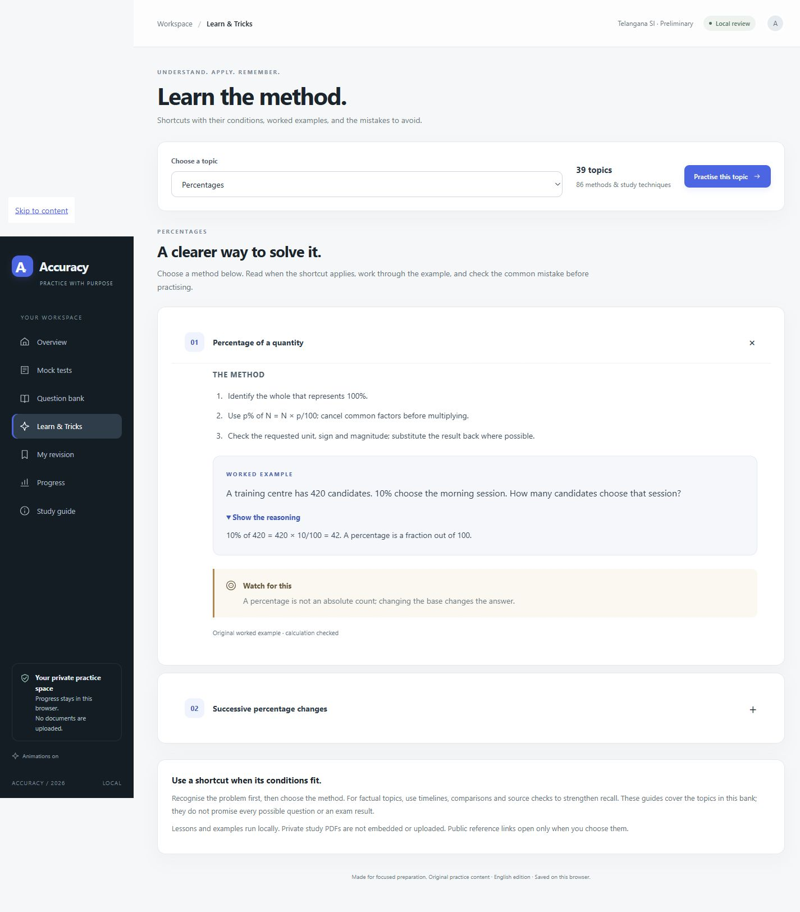

# Project Accuracy

Public source and local review build of **Accuracy**, a Telangana SI preliminary preparation application. Shared for review: the website has not been deployed.

## Open the app

Download this repository with **Code → Download ZIP**, extract it, and open `outputs/Accuracy.html` in a modern browser. On Windows, double-click `outputs/Open Accuracy.cmd`. Keep the same browser and file location for saved progress. No installation, account, server or internet is needed to use the app.

## Included

- 20 preliminary mock papers, 200 questions each.
- 4,000 authored questions and 16,000 option-specific explanations.
- Learn & Tricks: 39 topics and 86 methods, worked examples and common mistakes.
- Timed mocks, local save/resume, negative marking, results, search, bookmarks and backup import/export.
- Editable app, authoring modules, validation checks and review reports.

## Important content status

This is a review edition. No exact normalized question stem is reused across the papers, but the quantitative bank includes numerical/scenario variants from 50 families and 62 named forms. It does **not** meet a requirement that all 2,000 quantitative problem structures be different. The factual bank has targeted review, not independent expert certification. English preliminary coverage only. An 85% accuracy goal is a practice target, not an outcome guarantee.

Read [the validation report](outputs/ACCURACY-VALIDATION.md) and [the local user guide](outputs/ACCURACY-READ-ME.md).

## Rebuild

Python 3.10+ is used for the content/build scripts; they use the standard library. The browser application is buildless HTML/CSS/JavaScript.

```sh
python work/quant_content.py
python work/test_quant.py
python work/build_accuracy.py
node work/test_app_core.cjs
python work/audit_similarity.py outputs/accuracy/question-bank.json
python work/package_review.py
```

`outputs/accuracy/` holds the editable browser files and authored question bank. `work/` holds the original content generators, learning guides, exam pattern and audits. The self-contained `outputs/Accuracy.html` is generated from those files.

## Privacy and publication

The app source is public for review. Original PDFs, extracted/OCR paper text and images, local machine paths, credentials, saved student progress and temporary test fixtures are excluded. The source catalog contains only reference titles, categories and page counts. The runtime has no upload endpoint, analytics or external script/font dependency. Public source links open only when clicked; backups stay local.

No GitHub Pages configuration, hosting integration, or automatic deployment is included. Website deployment requires the owner's explicit approval after review.



